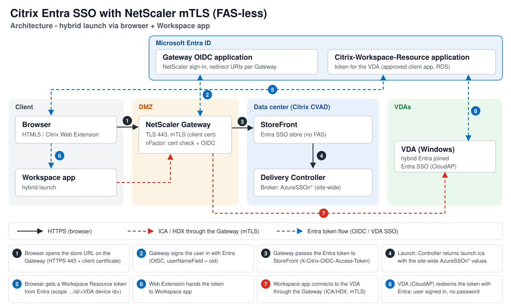
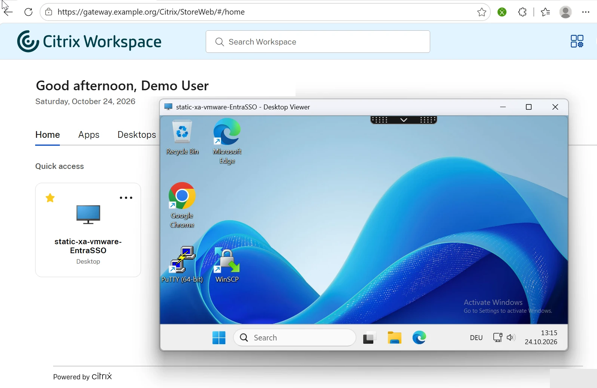
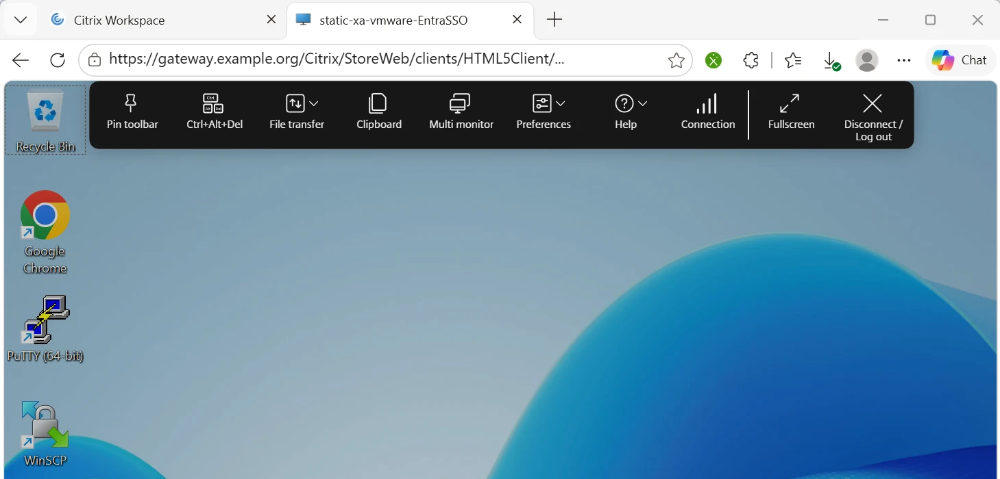
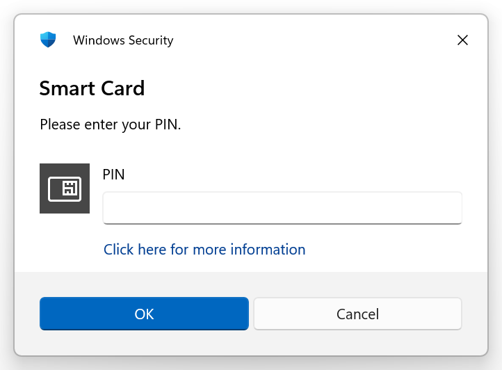
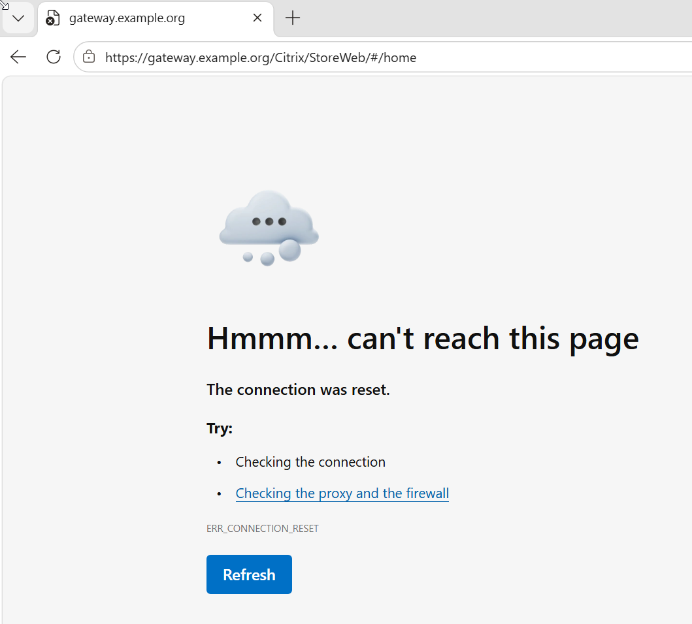

# citrix-entra-sso

Single sign-on with Microsoft Entra ID to Citrix Virtual Apps and Desktops **without FAS**, on-premises:
NetScaler Gateway (OIDC) -> StoreFront -> Entra hybrid joined VDAs (CVAD 2607 LTSR).

Status: v1.2 - verified end to end in a lab (HTML5 and hybrid, also through an mTLS Gateway with YubiKey PIV
certificates from the [client CA](docs/client-ca.md)). See [CHANGELOG](CHANGELOG.md).

## Architecture


> [!NOTE]
> **Validated:** HTML5 and hybrid browser-to-Workspace-app launches with mandatory NetScaler mTLS and FAS-free Entra
> SSO. Direct native Workspace app store enrollment through an mTLS-only Gateway is not supported by this
> implementation.

Settings per component and where each step can break: [docs/architecture.md](docs/architecture.md).

The user signs in **once** with Entra (passkey, Windows Hello or an existing Entra session; optionally behind a
client certificate on the Gateway). At launch the browser - the store page for HTML5, the Citrix Web Extension for
hybrid launches - gets an Entra token for the **Citrix-Workspace-Resource** application, scoped to the VDA's Entra
device id. The token travels with the HDX connection to the VDA, where CloudAP redeems it with Entra and signs the user
in: no password, no Windows logon screen, no FAS and no certificate authority for user certificates.

What has to fit together:

| Component | Key settings |
|---|---|
| Entra ID | Client application per Gateway (OIDC, SPA redirect URI = Store Web URL with `/`, `ctxaadsso://`), Citrix-Workspace-Resource with RDS protocol and approved client app, Conditional Access (phishing-resistant MFA) |
| NetScaler Gateway | nFactor: optional certificate check (NO_AUTHN), OIDC to Entra with user name `oid`, token rewrite to StoreFront, ICA proxy |
| StoreFront | store with Entra SSO enabled (no FAS), modern UI, CitrixAGBasic + CitrixFederation, Entra tenant |
| Delivery Controller | Broker site `AzureSSOnClientId` / `AzureSSOnAuthorizeUrl` / `AzureSSOnRedirectUrl` (**site-wide**), delivery group logon type HybridAzureAd |
| VDA | Entra hybrid joined (CVAD 2607 LTSR) |
| Client | Edge / Chrome with the Citrix Web Extension (hybrid), Workspace app, store on **port 443** |

## Client experience
| | |
|---|---|
|  |  |
| **Hybrid launch** (Edge + Citrix Web Extension -> Workspace app): the desktop opens signed in, no Windows logon screen. | **HTML5** in the browser, same single sign-on. |
|  |  |
| **mTLS Gateway (optional):** Workspace app asks for the smart card PIN for its own HDX connection. | **Without the client certificate** the Gateway resets the TLS connection - no logon page is exposed. |

*Lab screenshots, host and user names replaced with placeholders.* Tested clients and versions:
[client matrix](docs/troubleshooting.md#client-matrix-lab-2026-10).

## What this repo adds to the Citrix documentation
- **`AzureSSOnRedirectUrl` (Broker site, site-wide) must be the Store Web URL exactly as the browser sees it,
  with a trailing slash**, e.g. `https://gateway.example.org/Citrix/StoreWeb/`. The CVAD 2607 page only says it
  must be a redirect URI of the Client application and lists `ctxaadsso://citrix.aad.redirect` among them.
  With `ctxaadsso://...` as the Broker value every client launch fails: empty `about:blank` pop-up, ~60 s delay,
  then the Windows logon screen. See [docs/troubleshooting.md](docs/troubleshooting.md).
- The SPA redirect URI on the Client application must match that value (with the slash); the native Workspace app
  failed (froze) when only the variant without the slash was registered.
- A failure signature on the VDA that identifies the problem in minutes (CloudAP `0xC0048422` after a 31.4 s wait).
- Hybrid launches need the store on port 443, the Citrix Web Extension allowed on the store site, and (for Let's
  Encrypt Gateways) `ISRG Root X1` in the client's Windows root store. Details in the
  [troubleshooting guide](docs/troubleshooting.md).
- **One Entra SSO store per Citrix site** - see the limitation below.

## Limitation: one Entra SSO store origin per site
> [!IMPORTANT]
> **One Gateway / store per Citrix site.** The Entra SSO settings (`AzureSSOn*`: Client application, authorize URL
> with the tenant, redirect URL) are **site-wide** Broker settings, and the redirect URL must be the Store Web URL the
> browser sees. A Citrix site therefore gives browser (HTML5) and hybrid launches Entra SSO for **one Gateway URL + store
> and one Entra tenant**. Every other Gateway or store on the same site falls back to the Windows logon screen.
> **Service providers** running several customers (Gateways, stores, Entra tenants) on one shared site can offer Entra
> SSO without FAS to **one** of them only; the others need their own Citrix site or stay on FAS. A possible
> workaround idea is in the [ROADMAP](docs/ROADMAP.md).

**No override below the site** (checked on CVAD 2607 LTSR, all Citrix PowerShell snap-ins on the Delivery
Controller): the `AzureSSOn*` values exist only on `Set-BrokerSite`. Delivery groups only carry `MachineLogOnType`
(AD / HybridAzureAd / AzureAd), entitlement/access rules, catalogs and applications have no Entra SSO settings, and
the `AzureAD*` parameters of identity pools are for joining machines, not for user SSO. StoreFront keeps a tenant id
per store (`Set-STFEntraIdSettings`), but the Client application and redirect URL the client receives in the ICA
file come from the site.

A second store behind another Gateway URL, or reached directly on StoreFront, does not match; the HTML5 client then
logs "Azure Redirect URL does not match with the store origin and hence detecting as Multi tenant Entra ID store" and
SSO fails. A "multi tenant Entra ID store" mode exists in the HTML5 client but was not found to work on-premises.
Switching the site to another store means re-running the Broker settings (and the redirect URI on the Client
application).


*Lab, redacted: the site was pointed at a second Gateway (`dev-gateway.example.org:8461`, store `StoreDevWeb`). A user
on the first store (`gateway.example.org/Citrix/StoreWeb/`) launches a desktop; the browser pop-up is sent to the
**second** store with the second Client application - here unreachable from an external client whose proxy only allows
port 443 - and the session ends on the Windows logon screen.*

Check and switch the site on a Delivery Controller (Windows PowerShell, Citrix Broker snap-in):

```powershell
Add-PSSnapin Citrix.Broker.Admin.V2
# current values (keep them as the way back)
Get-BrokerSite | Select-Object AzureSSOnClientId, AzureSSOnRedirectUrl, AzureSSOnAuthorizeUrl, AzureSSOnResourceAppId
```
```powershell
# point the site at the Gateway + store that should get Entra SSO (trailing slash!)
Set-BrokerSite -AzureSSOnClientId '<client-app-id>' -AzureSSOnRedirectUrl 'https://gateway.example.org/Citrix/StoreWeb/'
```
The Client application must have that exact URL as SPA redirect URI. `scripts/Export-EntraSsoConfig.ps1` checks both.

## Scope
| Component | Version tested |
|---|---|
| CVAD / Delivery Controller / StoreFront | 2607 LTSR |
| VDA | 2607 LTSR on Windows Server 2025 (build >= 26100.32230), Entra hybrid joined |
| NetScaler | 14.1 (Gateway with nFactor OIDC to Entra, token rewrite to StoreFront) |
| Workspace app | Windows 2607.1 LTSR (26.7.1.4), 2607 (26.7.0.269) and 26.3.20.31, macOS 2609 (26.09.0.17) |
| Citrix Web Extension | 26.1.6 (Edge / Chrome); hybrid launches need the store on port 443 |
| NetScaler Gateway | OIDC to Entra, optional mTLS (`clientCert Mandatory`) verified for HTML5 and hybrid |

Not covered: Citrix DaaS / Citrix Cloud (own Citrix documentation), Entra joined (cloud-only) VDAs on CVAD
(not supported by Citrix on-premises), FAS.

## Layout
| Path | Content |
|---|---|
| `scripts/` | PowerShell: export of the current config, idempotent setup per component, validation |
| `netscaler/` | JSON object files for [netscaler-nitro](https://github.com/bensplittgerber/netscaler-nitro) (>= v1.2.0, v1.2.1 recommended): Entra OIDC nFactor, Gateway on 443 with token rewrite, optional mTLS |
| `pki/` | optional mTLS: step-ca client CA templates (CA config, leaf template, compose, nginx CRL) - see [client CA](docs/client-ca.md) |
| `config/` | `example.json` with placeholders; real values go into `*.local.json` (git-ignored) |
| `docs/` | [end-to-end deployment](docs/deployment.md), [architecture](docs/architecture.md), troubleshooting signatures, client matrix, limitations, [ROADMAP](docs/ROADMAP.md) (v1.1: end-to-end deployment with netscaler-nitro and netscaler-vpx-deploy), [release steps](docs/release.md) |

## Conventions
Placeholders only (`example.org`, `192.0.2.x`, `<tenant-id>`). No secrets in files or on command lines: client
secrets via masked prompts or `${env:NAME}`. The public Citrix multi-tenant app id `3a510bb1-e334-4298-831e-3eac97f8b26c`
(Citrix-Workspace-Resource) is not a secret. The architecture diagrams are own drawings (no vendor artwork or logos).
