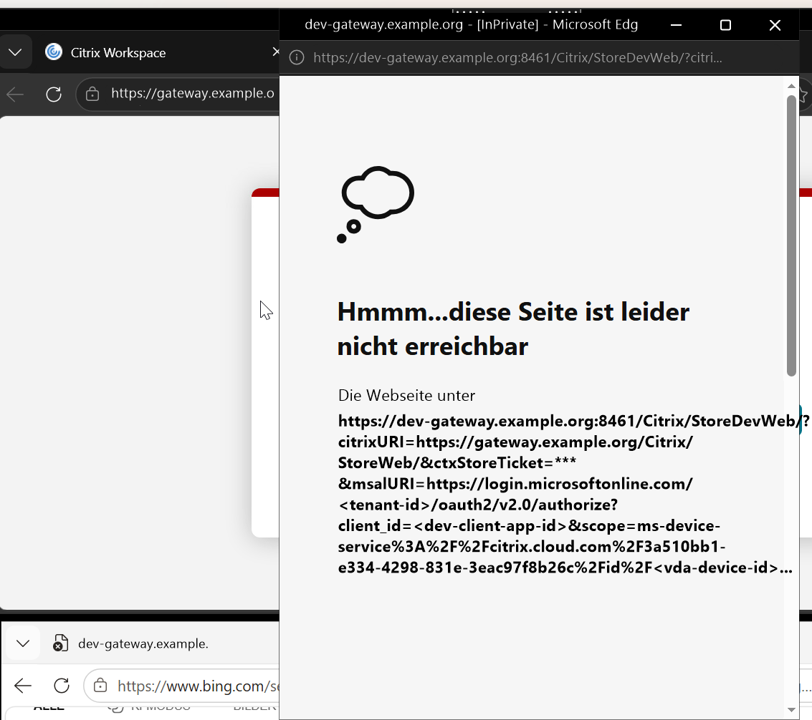

# citrix-entra-sso

Single sign-on with Microsoft Entra ID to Citrix Virtual Apps and Desktops **without FAS**, on-premises:
NetScaler Gateway (OIDC) -> StoreFront -> Entra hybrid joined VDAs (CVAD 2607 LTSR).

Status: work in progress. Verified end to end in a lab; the PowerShell automation is being built.

> [!IMPORTANT]
> **One Gateway / store per Citrix site.** The Entra SSO settings (`AzureSSOn*`: Client application, authorize URL
> with the tenant, redirect URL) are **site-wide** Broker settings, and the redirect URL must be the Store Web URL the
> browser sees. A Citrix site therefore gives browser (HTML5) and hybrid launches Entra SSO for **one Gateway URL + store
> and one Entra tenant**. Every other Gateway or store on the same site falls back to the Windows logon screen.
> **Service providers** running several customers (Gateways, stores, Entra tenants) on one shared site can offer Entra
> SSO without FAS to **one** of them only; the others need their own Citrix site or stay on FAS. Verified in the lab:
> with the site pointed at a second Gateway, the first store's pop-up was sent to the second Gateway's store.
> A "multi tenant Entra ID store" mode exists in the HTML5 client (log message on mismatch) but was not found to work
> on-premises. Details: [Limitation: one Entra SSO store origin per site](#limitation-one-entra-sso-store-origin-per-site).
>
> **No override below the site** (checked on CVAD 2607 LTSR, all Citrix PowerShell snap-ins on the Delivery
> Controller): the `AzureSSOn*` values exist only on `Set-BrokerSite`. Delivery groups only carry `MachineLogOnType`
> (AD / HybridAzureAd / AzureAd), entitlement/access rules, catalogs and applications have no Entra SSO settings, and
> the `AzureAD*` parameters of identity pools are for joining machines, not for user SSO. StoreFront keeps a tenant id
> per store (`Set-STFEntraIdSettings`), but the Client application and redirect URL the client receives in the ICA
> file come from the site.



*Lab, redacted: the site points at a second Gateway; a user of the first store gets the second store's pop-up.*

## What this repo adds to the Citrix documentation
- **`AzureSSOnRedirectUrl` (Broker site, site-wide) must be the Store Web URL exactly as the browser sees it,
  with a trailing slash**, e.g. `https://gateway.example.org/Citrix/StoreWeb/`. The CVAD 2607 page only says it
  must be a redirect URI of the Client application and lists `ctxaadsso://citrix.aad.redirect` among them.
  With `ctxaadsso://...` as the Broker value every client launch fails: empty `about:blank` pop-up, ~60 s delay,
  then the Windows logon screen. See [docs/troubleshooting.md](docs/troubleshooting.md).
- The SPA redirect URI on the Client application must match that value (with the slash); the native Workspace app
  failed (froze) when only the variant without the slash was registered.
- A failure signature on the VDA that identifies the problem in minutes (CloudAP `0xC0048422` after a 31.4 s wait).

## Limitation: one Entra SSO store origin per site
The `AzureSSOn*` values are **site-wide** Broker settings: one Client application and one redirect URL per Citrix
site. Because the redirect URL must equal the Store Web URL that the browser sees, browser (HTML5) and hybrid launches
get Entra SSO for **one store origin per site** (one Gateway URL + store). A second store behind another Gateway URL,
or reached directly on StoreFront, does not match; the HTML5 client then logs "Azure Redirect URL does not match with
the store origin and hence detecting as Multi tenant Entra ID store" and SSO fails. Not yet verified for the native
Workspace app. Switching the site to another store means re-running the Broker settings (and the redirect URI on the
Client application).

Example (screenshot at the top, lab, redacted): the site was pointed at a second Gateway (`dev-gateway.example.org:8461`, store `StoreDevWeb`).
A user on the first store (`gateway.example.org/Citrix/StoreWeb/`) launches a desktop; the browser pop-up is sent to the
**second** store with the second Client application - here unreachable from an external client whose proxy only allows
port 443 - and the session ends on the Windows logon screen.


Check and switch the site on a Delivery Controller (Windows PowerShell, Citrix Broker snap-in):

```powershell
Add-PSSnapin Citrix.Broker.Admin.V2
# current values (keep them as the way back)
Get-BrokerSite | Select-Object AzureSSOnClientId, AzureSSOnRedirectUrl, AzureSSOnAuthorizeUrl, AzureSSOnResourceAppId
```
```powershell
# point the site at the Gateway + store that should get Entra SSO (trailing slash!)
Set-BrokerSite -AzureSSOnClientId '<client-app-id>' -AzureSSOnRedirectUrl 'https://gateway.example.org/Citrix/StoreWeb/'
```
The Client application must have that exact URL as SPA redirect URI. `scripts/Export-EntraSsoConfig.ps1` checks both.

## Scope
| Component | Version tested |
|---|---|
| CVAD / Delivery Controller / StoreFront | 2607 LTSR |
| VDA | 2607 LTSR on Windows Server 2025 (build >= 26100.32230), Entra hybrid joined |
| NetScaler | 14.1 (Gateway with nFactor OIDC to Entra, token rewrite to StoreFront) |
| Workspace app | Windows 2607 (64-bit), macOS 2609 |

Not covered: Citrix DaaS / Citrix Cloud (own Citrix documentation), Entra joined (cloud-only) VDAs on CVAD
(not supported by Citrix on-premises), FAS.

## Layout
| Path | Content |
|---|---|
| `scripts/` | PowerShell: export of the current config, idempotent setup per component, validation |
| `config/` | `example.json` with placeholders; real values go into `*.local.json` (git-ignored) |
| `docs/` | troubleshooting signatures, client matrix, limitations |

## Conventions
Placeholders only (`example.org`, `192.0.2.x`, `<tenant-id>`). No secrets in files or on command lines: client
secrets via masked prompts or `${env:NAME}`. The public Citrix multi-tenant app id `3a510bb1-e334-4298-831e-3eac97f8b26c`
(Citrix-Workspace-Resource) is not a secret.
