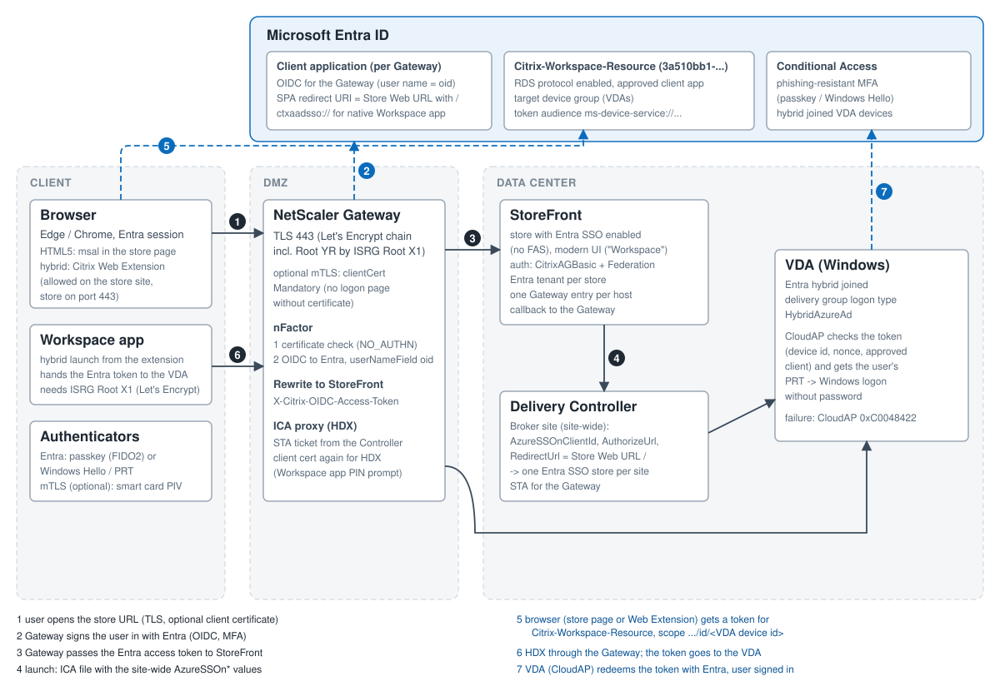

# Architecture in detail

## Logon flow (hybrid launch through an mTLS Gateway)
| # | Step | Where it breaks (see [troubleshooting](troubleshooting.md)) |
|---|---|---|
| 1 | The browser opens the store URL on the Gateway (HTTPS 443; with mTLS the TLS handshake requires the client certificate). | No certificate: connection reset (intended). Store on a custom port: hybrid fails later at step 5. |
| 2 | nFactor: certificate check without a user name (NO_AUTHN), then OIDC to Entra with `userNameField oid`; Conditional Access applies (phishing-resistant MFA). | User name = UPN instead of the object id: StoreFront refuses Entra SSO. |
| 3 | A rewrite passes the Entra access token to StoreFront (`X-Citrix-OIDC-Access-Token`); StoreFront validates it and enumerates the resources. | Store web site not on the modern UI: no Entra token flow at launch. |
| 4 | Launch: StoreFront gets the launch data from the Delivery Controller; the ICA file carries the **site-wide** `AzureSSOnClientId`, `AzureSSOnAuthorizeUrl`, `AzureSSOnRedirectUrl` and the VDA's Entra device id. | Redirect URL not equal to the Store Web URL (with `/`): no SSO. Only one store per site. |
| 5 | The browser - the store page for HTML5, the Citrix Web Extension for hybrid - gets a token for **Citrix-Workspace-Resource**, scope `ms-device-service://citrix.cloud.com/3a510bb1-.../id/<VDA device id>/user_impersonation`, silently with the Entra session. | Extension not allowed on the store site, or store on a custom port: no token request at all. |
| 6 | Hybrid only: the Web Extension hands the token to Workspace app. | - |
| 7 | Workspace app connects to the VDA through the Gateway (ICA/HDX; with mTLS it presents the client certificate again, PIN prompt). | Gateway certificate chain not trusted by Workspace app (Let's Encrypt without ISRG Root X1 on the client): SSL error 65. |
| 8 | The VDA (CloudAP) redeems the token with Entra, gets the user's PRT and signs the user in without a password. | No token arrives: CloudAP `0xC0048422` after ~31 s, Windows logon screen. |

HTML5 launches skip step 6; the HTML5 client in the browser does steps 5 and 7 itself.
