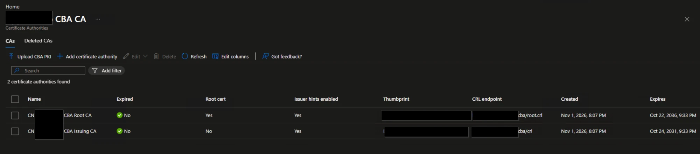
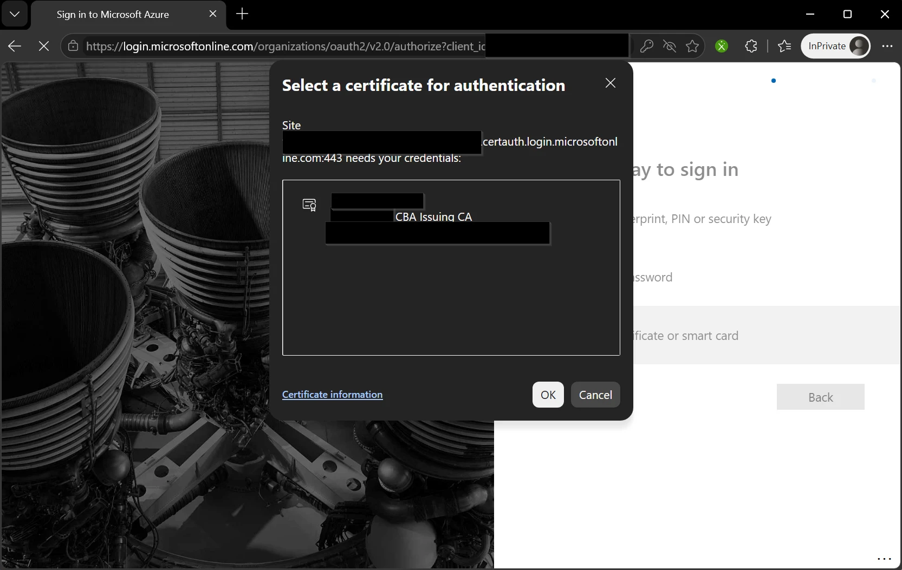
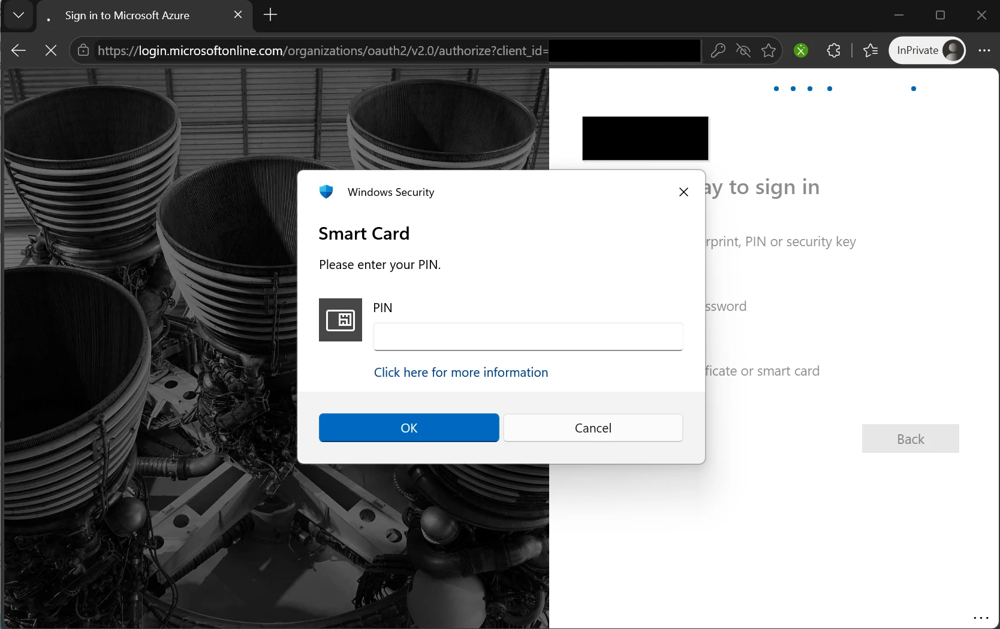
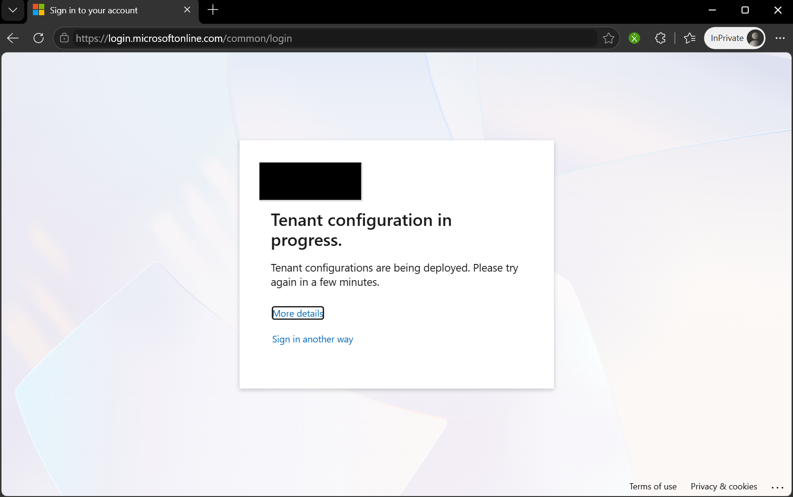
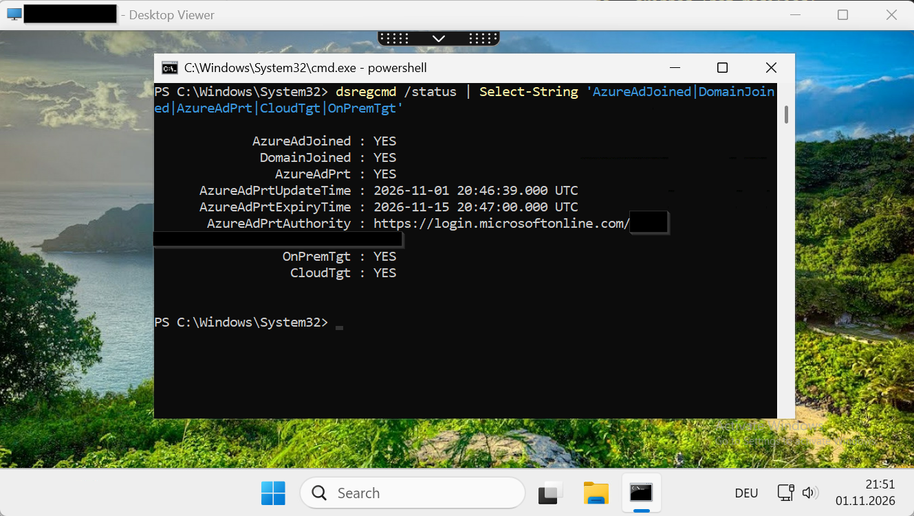

# Entra certificate-based authentication (CBA) with your own CA - lessons

Optional, next to Entra SSO: users sign in to Entra with a smart card certificate of an own CA (here a step-ca
"CBA CA": RSA root + issuing CA, leaf CN = UPN, SAN email + UPN otherName, EKU clientAuth, key generated on a
YubiKey). Also covers what Entra CBA means for **FAS** desktops: a hybrid joined VDA gets the user's PRT from the
FAS smart card logon only through Entra CBA.

Lab-tested 2026-11 (Graph v1.0 PKI store, beta method policy, Windows 11 / Edge, YubiKey 5C Nano).

## Setup in short
1. Publish the CRLs over HTTP **before** the upload: the issuing CA's CRL (`http://pki.example.org/cba/crl`) and a
   CRL signed by the root that covers the issuing CA (`http://pki.example.org/cba/root.crl`).
2. Trust store (PKI store, `directory/publicKeyInfrastructure`): one PKI object per CA hierarchy, root
   (`certificateAuthorityType: root`, CRL = root CRL) + issuing (`intermediate`, CRL = issuing CRL).
3. Method policy (`authenticationMethodConfigurations/X509Certificate`): username binding
   `PrincipalName -> userPrincipalName`, a rule that rates the issuing CA as multi-factor, optional CA scope
   (issuing CA SKI -> group).
4. Users: in the policy's include group and **not** in any exclusion group.

| | |
|---|---|
|  |  |
| **PKI store:** root + issuing CA, issuer hints on, one CRL URL per entry. | **Issuer hints:** the picker on `certauth.login.microsoftonline.com` offers only the CBA certificate, although the card holds more. |
|  |  |
| **PIN** of the YubiKey PIV applet; the sign-in log then shows `X.509 Certificate`, `multiFactorAuthentication`. | **After a CA list change:** "Tenant configuration in progress" (`AADSTS2205016`) for every certificate sign-in. |

## Lessons
* **PKI store upload: send only `certificate`, `certificateAuthorityType`, `certificateRevocationListUrl`,
  `isIssuerHintEnabled`.** The Graph docs list `displayName`, `thumbprint`, `expirationDateTime` as settable or even
  required; Entra answers `400 Invalid value specified for property 'displayName'` (then `'thumbprint'`) and derives
  them from the certificate itself.
* **Entra uses the CRL URL stored on the CA entry,** not the CDP in the certificate. The root entry's URL must be a
  CRL signed by the root (it checks the issuing CA certificate), the issuing entry's URL the CRL for the leaves.
* **CRL validation enabled** = a trusted CA without a CRL URL fails unless its SKI is exempted. A CA with a working
  CRL should not be exempted; then an unreachable or expired CRL blocks all its sign-ins - monitor the CRL's
  `nextUpdate`.
* **Issuer hints:** with hints on, Entra sends the trusted CA names in the TLS handshake and the browser picker shows
  only matching certificates (a card with several PIV certificates shows just the right one). Price: **after every
  change of the CA list the whole tenant's certificate sign-in is blocked** for a while with
  `AADSTS2205016 Tenant's configuration for issuer hints is being provisioned` ("Tenant configuration in progress"
  page), for *all* trusted CAs. Lab: between ~50 and ~90 minutes after the upload. Change the CA list in a
  maintenance window.
* **No certificate policy OID in the leaf** -> rate the CA with an `issuerSubject` rule (identifier = the issuing CA
  subject as Entra writes it, e.g. `CN=Example CBA Issuing CA`). With the multi-factor rule the certificate alone
  satisfies MFA and the built-in "Phishing-resistant MFA" strength (sign-in log: `multiFactorAuthentication`,
  method `X.509 Certificate`). Custom strengths with `allowedIssuerSkis` accept only the listed CAs.
* **PATCH of the X509Certificate configuration replaces whole collections** (`authenticationModeConfiguration.rules`,
  `certificateAuthorityScopes`, bindings). Read the policy, append, send the full lists back; keep the JSON from before
  the change for rollback. Fields not sent stay unchanged.
* **Exclusion beats inclusion.** A user in both the include and an exclusion group has CBA off. Sign-in log
  signature: `500186 Access denied. Certificate-based authentication is disabled for the user.`
* **The certificate option appears only after the username.** Entra's pre-username "Sign-in options" page (passkey,
  "Sign in with GitHub") never lists it; type the UPN, then "Other ways to sign in" -> "Use a certificate or smart
  card".
* **Synced users and high affinity:** `certificateUserIds` (e.g. `X509:<I>...<SR>...`) of a synced user cannot be
  written in the cloud; it has to come from AD through the sync. Low affinity (UPN binding) works without it.

## FAS desktops: PRT through CBA
A FAS session logs the user on to the VDA with a FAS virtual smart card certificate, no password. On a **hybrid
joined** VDA, CloudAP then requests the PRT with that certificate - an Entra CBA sign-in (app "Windows Sign In",
**non-interactive**, method `X.509 Certificate`). It succeeds only if the FAS issuing CA is in the Entra trust store
and the user is in CBA scope. Lab result:

| User state | Sign-in log "Windows Sign In" | `dsregcmd /status` in the session |
|---|---|---|
| in the CBA exclusion group | `500186 Certificate-based authentication is disabled for the user` | `AzureAdPrt : NO` |
| removed from the exclusion | success, `X.509 Certificate`, single-factor | `AzureAdPrt : YES`, `OnPremTgt : YES`, `CloudTgt : YES` |



The default `auditLogs/signIns` query returns interactive sign-ins only - filter
`signInEventTypes/any(t: t eq 'nonInteractiveUser')` to see the PRT request.

Read-only Graph query (Microsoft.Graph.Authentication is enough):
```powershell
Connect-MgGraph -Scopes AuditLog.Read.All -NoWelcome
(Invoke-MgGraphRequest -Method GET -OutputType PSObject -Uri "https://graph.microsoft.com/beta/auditLogs/signIns?`$filter=userPrincipalName eq 'user@example.org' and appDisplayName eq 'Windows Sign In' and (signInEventTypes/any(t: t eq 'interactiveUser' or t eq 'nonInteractiveUser'))&`$top=10").value |
  ForEach-Object { '{0:u} | {1} {2} | {3} | {4}' -f [datetime]$_.createdDateTime, $_.status.errorCode, $_.status.failureReason,
    ($_.signInEventTypes -join ','), (($_.authenticationDetails | ForEach-Object { "$($_.authenticationMethod) $($_.succeeded)" }) -join '; ') }
```
