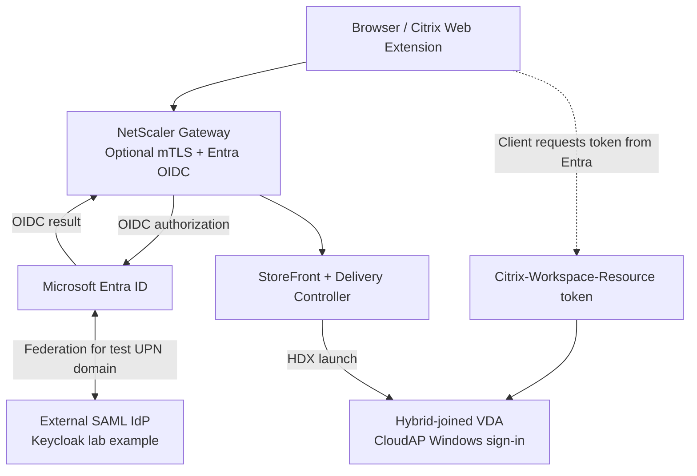

# External IdP federation compatibility — validation plan

**Status: proposed / not yet validated.** This is a compatibility investigation for the existing **FAS-free Entra SSO** design, not a new authentication implementation or a release claim.

## Objective

Determine whether the existing CVAD on-premises Entra SSO design still works when the **user's Entra UPN domain is federated to an external SAML IdP**, rather than using Entra-native primary authentication.

The test must establish both:

1. The browser/gateway login succeeds through the external IdP and Microsoft Entra returns an acceptable OIDC identity to NetScaler.
2. The browser obtains the **Citrix-Workspace-Resource** token and a **hybrid-joined VDA** completes real Windows session sign-in via CloudAP, **without FAS**.

**A successful upstream SAML or OIDC login is not sufficient evidence of VDA SSO.**

## Architecture under test

This flow is conceptual: actual redirects, federation trust and token transport must be confirmed in traces. It is **not** the same as configuring NetScaler to use Keycloak directly as its OIDC IdP.

## Scope and isolation

- Create/use an independently controlled **verified test UPN domain** with an existing synchronized user. Keep another authentication domain and independent cloud-only admin access unaffected.
- First external IdP: **Keycloak as SAML identity provider** for Entra. Compare against the existing Entra-native baseline.
- If an existing external provider is replaced, securely **export all current federation configuration and signing/rollover material references**, inventory affected users, check recovery accounts, and establish a fully tested rollback procedure before switching.
- Domain federation can affect **all identities associated with the domain**, not just Citrix test users.
- Preserve the existing direct-to-Keycloak emergency Gateway, if any; it is separate from the Entra-to-Keycloak federation trust.
- No production/customer identifiers, real UPNs, tenant IDs, secrets or log traces in this **public** repository. Use placeholders and redacted synthetic evidence.

## Test matrix

| Case | Authentication route | Launch mode | Assertion to verify |
|---|---|---|---|
| Baseline | Entra-native | HTML5 | VDA Windows SSO without FAS still works |
| Baseline | Entra-native | Hybrid browser-to-Workspace | VDA Windows SSO without FAS still works |
| Federated | Entra → Keycloak SAML | HTML5 | End-to-end VDA Windows SSO, not merely OIDC login |
| Federated | Entra → Keycloak SAML | Hybrid browser-to-Workspace | Resource token and CloudAP Windows sign-in succeed |
| Federated | Keycloak WebAuthn/FIDO2 | HTML5 / hybrid | Verify Entra MFA/Conditional Access classification; do not assume phishing-resistant strength |
| Optional | Entra-native passkey on federated UPN | HTML5 / hybrid | Observe whether Entra handles it directly or routes to external IdP |
| Negative | Bad/missing external SAML assertion | Login | Fail safely with identifiable source |
| Negative | Missing/blocked Citrix resource token | Launch | Distinguish token error from VDA/HDX error |
| Rollback | Original provider restored | Both modes | Original federation and Citrix behavior restored |

## Prerequisites and questions

- Entra user/AD user alignment: UPN, synchronized sourceAnchor/ImmutableID and identity claims from external IdP.
- Entra third-party SAML IdP trust and signing certificates configured using currently supported Graph interfaces.
- Hybrid join and Entra Kerberos prerequisites for the relevant AD domain, plus CVAD 2607 LTSR Entra SSO requirements.
- NetScaler Entra OIDC and StoreFront/Broker **site-wide** `AzureSSOn*` settings remain as in the validated baseline.
- External authentication result vs Entra Conditional Access, federated MFA claims and required authentication strength: test rather than assume.
- Client extension, third-party-cookie requirements and Citrix-Workspace-Resource consent/approved-client configuration unchanged from baseline.
- Existing mTLS Gateway behavior must be checked separately; mTLS certificate UPN and Entra OIDC identity may differ.

## Evidence checklist

- [ ] Entra sign-in shows correct user and observed federation route.
- [ ] External IdP audit records matching login, without secrets or personal data in reports.
- [ ] NetScaler OIDC result and StoreFront enumeration map to intended Entra user.
- [ ] Citrix-Workspace-Resource request identified by resource ID, success and time.
- [ ] HTML5/Hybrid launch carries appropriate token and HDX connection proceeds.
- [ ] VDA event evidence confirms **actual Windows session SSO**, no Windows login prompt and no FAS.
- [ ] Negative test identifies whether the fault belongs to external IdP, Entra, Citrix resource-token flow, StoreFront/Broker or VDA/CloudAP.
- [ ] Securely restore original federation configuration and rerun baseline.
- [ ] Record exact client/VDA/CVAD/NetScaler/IdP versions and known limitations.

## Acceptance criteria

A **validated** result requires both HTML5 and hybrid launch evidence on a hybrid-joined VDA with no FAS, plus an explicit MFA/Conditional Access finding and successful rollback. If only one mode works, document it as partial compatibility.

No edits to the established Grafana, Loki or MCP monitoring backend are required for this stage. Optional expanded observability is a separate later effort.

## Publication discipline

Do not update the README's verified version/feature statements or release notes until the tests are completed. When evidence exists, publish only sanitized findings, clear supported/unsupported/unknown behavior and explicit prerequisites.
