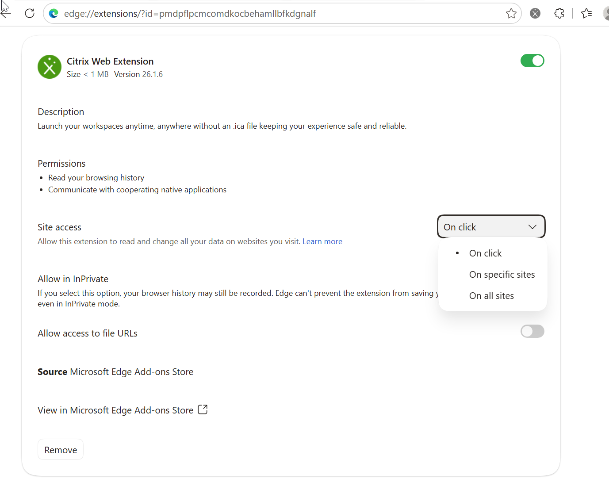

# Troubleshooting Entra SSO without FAS

## Failure signature on the VDA (wrong Broker redirect URL)
Per launch, in the VDA event logs (times relative to the ICA connect):

| T | Log | Event |
|---|---|---|
| 0 s | System, TdIca 1004 | connect request from the Gateway SNIP |
| +30 s | System, wdica 3005 | "Auto Client Reconnect (ACR) is disabled when using Azure AD authentication" -> the VDA is in Entra mode |
| +30 s | AAD/Analytic 1143 | CloudAP `GenericCallPkg` call type 9 -> `0x0` (challenge created) |
| +61 s | AAD/Analytic 1143, AAD/Operational 1104 | call type 10 -> **`0xC0048422`** within 1 ms (no client answer to check) |
| +61 s | - | no Winlogon "Authentication started", Windows logon screen |

Entra sign-in logs show **no** request for `Citrix-Workspace-Resource` (interactive or non-interactive).
The AAD Analytic log is off by default and can only be read after disabling it again:
`wevtutil sl Microsoft-Windows-AAD/Analytic /e:true /q:true` ... launch ... `wevtutil sl Microsoft-Windows-AAD/Analytic /e:false`.

Working launch for comparison: ICA-CGP within ~2 s, Winlogon "Authentication stopped. Result 0", no 1104, desktop
in ~10 s.

## Client side
- Pop-up stays `about:blank`; in a hybrid launch the StoreFront page navigates it to
  `ctxaadsso://citrix.aad.redirect?citrixURI=...&ctxStoreTicket=...&msalURI=<Entra authorize URL>`.
- HTML5 client log (Download log in the "Session failure" dialog), repeating every ~30 ms:
  `MSALWrapper.detectInteractionTypeForH5 ... Azure Redirect URL does not match with the store origin` -> `REDIRECT_TO_CTX_HTTPS`.
- Fix: `Set-BrokerSite -AzureSSOnRedirectUrl 'https://<gateway-fqdn>/Citrix/<Store>Web/'`.

## Ruled out along the way (all correct in the failing setup)
Entra Resource app enabled and `isRemoteDesktopProtocolEnabled`, Client app approved, admin consent,
VDA in the target device group, `AzureSSOnResourceAppId = citrix.cloud.com/3a510bb1-...` (matches the SPN
`ms-device-service://citrix.cloud.com/3a510bb1-...`), token rewrite on the Gateway, Citrix Web Extension and native
messaging host, VDA prerequisites. RDP with Entra SSO to the same VDA worked (host side fine).

## Client matrix (lab, 2026-10)
| Client | HTML5 | Hybrid (browser -> Workspace app) | Native Workspace app |
|---|---|---|---|
| Windows 11, Chrome | OK | OK (Web Extension 26.1.6 + Workspace app 2607.1), also through an mTLS Gateway | OK (store added in Workspace app; not via an mTLS Gateway) |
| Windows 11, Edge | OK | OK **only with the Citrix Web Extension allowed on the store site** (site access "On all sites" or the store URL; with "On click" the launch ends on the Windows logon screen), also through an mTLS Gateway | OK |
| Windows 11 laptop, hybrid joined, Windows Hello logon, mobile hotspot (external), Chrome | OK (mTLS Gateway) | OK (Workspace app 2607, 26.7.0.269, mTLS Gateway) | not tested |
| Windows Server 2022 (remote worker, RDP), Edge | OK | OK (Workspace app 26.3.20.31, mTLS Gateway, smart card via RDP redirection) **after ISRG Root X1 was in the machine root store** (see Let's Encrypt below) | not tested |
| macOS, Chrome | OK | OK (Workspace app for Mac 2609), also through an mTLS Gateway | OK |
| macOS, Safari | OK | **not supported** (Citrix: hybrid only Edge/Chrome + Web Extension) | - |
| iPadOS, embedded web view | not supported (WebKit; also no FIDO2) | - | not tested |

Hybrid launches in all rows need the store on **port 443** (see "store URL with a custom port").
Requirements seen in tests: pop-ups allowed for the store; on macOS browsers the silent Entra request (`prompt=none`)
needs the Entra session cookie (worked with "Stay signed in" (KMSI) enabled; KMSI-off matrix pending).

## NetScaler OIDC action: user name must be the Entra object id
StoreFront (Entra SSO enabled on the store) shows "Cannot complete your request." and logs:
`Entra ID single sign-on failed because the username '<upn>' passed by Citrix Gateway is not an Entra OID (GUID format).
Resolution: In the NetScaler OIDC policy action, set the username field to 'oid'.`
Fix: `set authentication OAuthAction <name> -userNameField oid` (the working reference Gateway used `oid` from the start;
`preferred_username` or `upn` fail).

## Store web site must use the modern UI ("Workspace" experience)
With `userInterfaceExperience experience="ReceiverForWeb"` in the Web Receiver web.config, the store page launches with a
plain ICA download (`Resources/LaunchIca`) and never starts the Entra token flow (no `Tickets/RequestStoreTicket`, no
`ctxaadsso://` handoff, no Entra request). The VDA then shows the failure signature above (Entra mode, 31 s wait,
CloudAP `0xC0048422`). `Add-STFWebReceiverService -ClassicReceiverExperience $false` does not set the modern UI; use
`-WebUIExperence Workspace` (Add, sic) or `Set-STFWebReceiverService -WebUIExperience Workspace`. Found with an Edge
`edge://net-export` log of a hybrid launch (2026-10-23).

## NetScaler OIDC action: no userinfo endpoint
With `-metadataUrl` the OAuth action also takes the Graph `userinfo` endpoint, and the user name field is then read from
the userinfo answer, which has no `oid` -> the user name falls back to the UPN and StoreFront refuses Entra SSO. Configure
the endpoints explicitly (authorization, token, keys, issuer, audience) without `metadataUrl` / `userInfoURL`
(lab 2026-10-23; the working reference Gateway had neither).

## mTLS Gateway in front of the store
nFactor keeps the user name of the first factor. A client certificate factor that sets the user name (UPN from the SAN)
therefore hides the Entra `oid`; use a certificate check without a user name (`-action NO_AUTHN`, rule
`CLIENT.SSL.CLIENT_CERT.EXISTS`) as factor 1. The certificate is still enforced by the SSL profile. Note: certificate
and Entra user are then no longer coupled (add a UPN comparison). Native Workspace app cannot add an account on a
Gateway that requires a client certificate; only browser / hybrid launches.

Verified end to end with `-clientCert Mandatory` (lab 2026-10-24, YubiKey PIV for the client certificate, YubiKey
FIDO2 passkey for Entra): HTML5 and hybrid launches (Windows 11 Edge/Chrome, macOS Chrome, Windows Server remote
worker over RDP smart card redirection) log on with Entra SSO within seconds; Workspace app asks for the smart card
PIN for its own HDX connection to the Gateway. Without the smart card the browser gets `ERR_CONNECTION_RESET` - no
logon page is exposed.
- Keep **Mandatory**. With `Optional` a client without certificate completes TLS and the Gateway shows the default
  user name / password form (no login schema bound, no policy matches, so a logon fails - but the Gateway is exposed
  and a later fallback policy would open a password path).
- Routing HDX through a second Gateway without client certificate ("optimal HDX routing") is not needed. If used, put
  it on a separate NetScaler: pre-auth memory disclosure bugs (CitrixBleed type) read packet-engine memory, so an
  unprotected vServer on the same appliance exposes the session tokens of the mTLS Gateway.
- Only one StoreFront Gateway entry per host on the store. With two entries for the same FQDN (here the old
  `:8461` listener and the new `:443` one) StoreFront wrote the first one into the ICA file; HDX then went to the old
  port (HTML5: WebSocket 1006 from networks that block it). Unregister the old entry from the store.

## Browser launches on the LAN: Local Network Access (Chromium)
On the LAN the Gateway FQDN resolves to a private address. The silent Entra request of the HTML5 client
(`prompt=none`, hidden iframe) returns from `login.microsoftonline.com` to the store URL; Edge/Chrome block that with
`ERR_BLOCKED_BY_LOCAL_NETWORK_ACCESS_CHECKS` (Local Network Access: a public page may not load a private address in
an iframe). msal then falls back to an interactive pop-up, which works -> SSO succeeds, but slower and only with
pop-ups allowed. From outside (Gateway FQDN = public address) the log shows no such block (external test 2026-10-24).

## Clients behind a TLS-inspecting proxy (e.g. Zscaler SSL inspection)
External test through Zscaler (2026-10-24): the store and the Entra part work - HTML5 log `Received AAD token
successfully from MSAL` - but the HDX connection fails: HTML5 log `WebSocket connection failed with error code 1006`,
Edge net-export `WEBSOCKET_UPGRADE_FAILURE` / `ERR_INVALID_RESPONSE` towards the Gateway. This is the proxy, not Entra
SSO. Fix on the proxy side: exclude the Gateway FQDN from SSL inspection (and allow WebSockets). A Gateway that
requires a client certificate (mTLS) cannot work through SSL inspection at all.

## Hybrid launch in Edge: Citrix Web Extension site access
Symptom (Windows 11, Edge, hybrid launch = browser -> Workspace app): the browser gets the Entra token in time (Edge
net-export: silent `authorize` + `token` 200 before Workspace app connects), but the VDA never receives it - Entra mode
after 30 s, CloudAP `0xC0048422`, Windows logon screen. The same PC, Workspace app and store work in Chrome, and HTML5
and native launches work in Edge.
Cause: the Citrix Web Extension in Edge had **Site access = "On click"**, so it does not run on the store page and the
token handoff to Workspace app does not happen. Fix: `edge://extensions` -> Citrix Web Extension -> Site access
**"On specific sites"** (store / Gateway URL) or **"On all sites"**; for managed devices set it centrally with the
Edge policy `ExtensionSettings` for the extension id `pmdpflpcmcomdkocbehamllbfkdgnalf` (Edge Add-ons; Chrome id
`dbdlmgpfijccjgnnpacnamgdfmljoeee`), e.g. `runtime_allowed_hosts` with the Gateway URL. Verified 2026-10-24: after the
change Entra mode at connect, Windows logon after 2 s.

 (The Workspace app native messaging host being registered only
under the Chrome registry keys was a red herring - not needed for Edge.)

## Hybrid launch: store URL with a custom port (Citrix Web Extension)
Symptom (lab 2026-10-24, extension 26.1.6, Edge, site access "On all sites"): store behind a Gateway on a custom port
(`https://gateway.example.org:8461/Citrix/StoreWeb/`, Broker redirect URL with the same port). HTML5 launches work with
Entra SSO, hybrid launches end on the Windows logon screen (VDA failure signature above). The browser sends only
`GetLaunchStatus` and `LaunchIca` (`LaunchMechanism=Browser_Extension`) and **no** Entra request for
Citrix-Workspace-Resource; Workspace app does not request one either. In a working hybrid launch the Entra sign-in log
shows the Client application requesting Citrix-Workspace-Resource with client app "Browser" right before Workspace
app connects.
Cause (extension 26.1.6, `CitrixBrowserExtension.js`): the extension only registers a tab as the Entra SSO store tab
(`saveActiveWSUITabForAADSSO` -> `isCitrixStoreUrl`) when its URL matches `https{0,1}://[\w|\.|\-]+/Citrix/.*`.
The host part allows no `:`, so `https://gateway.example.org:8461/Citrix/...` never matches; the store page still
launches through the extension, but the Entra token handoff to Workspace app never starts. The same pattern also
means the store path must start with `/Citrix/`.
Fix: publish the Entra SSO store on port 443 (own IP or FQDN for that Gateway), with the Broker redirect URL, the SPA
redirect URI and the NetScaler OIDC redirect URI (`https://<gateway>/oauth/login`) without the port. Verified
2026-10-24: same Gateway, store and mTLS settings on :443 -> the extension starts the token flow (silent `authorize`
with `ms-device-service://.../id/<vda-device-id>/user_impersonation`, `token` 200) and hybrid SSO works. Watch out for
browser address bar suggestions of the old `:port` URL during tests.

## Let's Encrypt Gateway certificates and native Workspace app (BYOD)
Symptom: browser and HTML5 work, but Workspace app (native or hybrid) fails right away with
`SSL Error 65: SSL_STATUS_X509ERR_UNABLE_TO_GET_ISSUER_CERT_LOCALLY` and never asks for the smart card PIN.
Lab 2026-10-24: remote worker Windows Server 2022, Workspace app 26.3.20.31.
Cause: Let's Encrypt's Y generation chain is `leaf <- YR2 <- Root YR <- ISRG Root X1` (Root YR is not yet in the
major trust stores; Let's Encrypt's default chain carries Root YR cross-signed by ISRG Root X1). Workspace app checks
against the Windows machine root store, and Windows adds a trusted root there only when the Windows certificate
chain engine (CryptoAPI) requests it (Automatic Root Update). Browsers use their own root store and never trigger
that, so a fresh or rarely used device can lack `ISRG Root X1` although the store opens fine in the browser.
Recommendation:
- Gateway (server side): send the full chain including the **Root YR cross-signed by ISRG Root X1**
  (`link ssl certKey <YR2> <Root YR by X1>`), so every client that trusts X1 can build the chain. Never end the
  chain at the self-signed Root YR.
- Managed devices: distribute `ISRG Root X1` (GPO / Intune) or make sure Automatic Root Update is allowed
  (GPO "Turn off Automatic Root Certificates Update" not enabled, `ctldl.windowsupdate.com` reachable).
- BYOD / unmanaged devices: in the user guide, one command that lets Windows install the root itself (no admin):
  `certutil -urlfetch -verify root-yr-by-x1.pem` (file from letsencrypt.org/certificates); afterwards
  `CN=ISRG Root X1` is in `Cert:\LocalMachine\Root`. Verified on the remote worker; the next launch worked.
- Check: `Get-ChildItem Cert:\LocalMachine\Root | ? Subject -match 'ISRG'`.

## Conditional Access sign-in frequency: the first launch after the period can fail
Symptom (lab 2026-10-25, Conditional Access policy on Citrix-Workspace-Resource with phishing-resistant MFA and a
sign-in frequency of 1 hour, W11, Edge): the store logon through the Gateway works without a prompt, but the first
launch after the sign-in frequency has run out fails:
- hybrid: Workspace app connects, the VDA waits and then shows the Windows logon screen (failure signature above,
  `0xC0048422`);
- HTML5: the launch pop-up asks to sign in again (passkey / Windows Hello) and the session ends with "Citrix Workspace
  app cannot connect to the server".

The next launch right after that sign-in works for both, and repeated launches within the period need no prompt.
The token for the VDA is requested at launch time, so a re-authentication that Conditional Access demands lands inside
the launch, and the VDA does not wait for an interactive sign-in (about 30 s, see the failure signature).

What to do:
- Plan the sign-in frequency on Citrix-Workspace-Resource with this in mind: a short period means one failed first
  launch per period. Prefer a longer period. Moving the sign-in frequency to the store sign-in (the Client application),
  so the re-authentication happens at the Gateway logon instead of inside a launch, is an option that was not tested.
- Tell users: if the first launch shows the Windows logon screen or "cannot connect" after a sign-in prompt, launch
  again.
- In the re-authentication pop-up Entra offers the account's default method first (a password alone does not satisfy
  phishing-resistant MFA); "Sign in another way" leads straight to passkey / Windows Hello.
