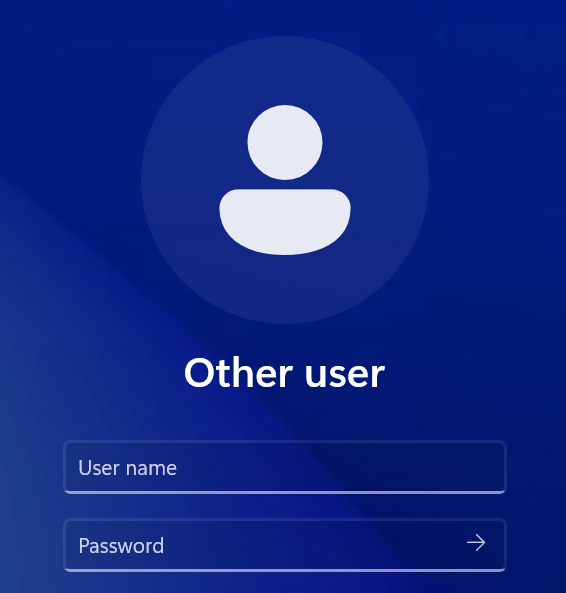
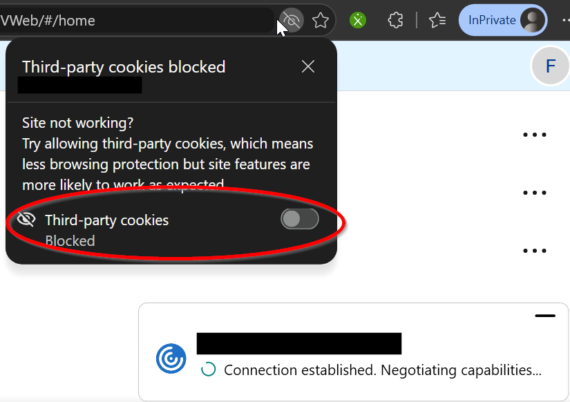
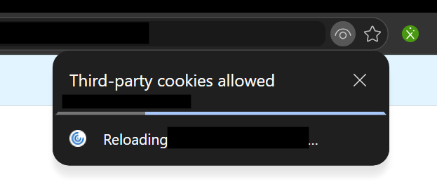

# User guide: browser settings for Entra SSO

What a user needs on the client so that a desktop or app opens **signed in**, without the Windows logon screen.
For administrators: the background and the lab findings are in [troubleshooting](troubleshooting.md).

## Checklist
| Setting | Why |
|---|---|
| Edge or Chrome with the **Citrix Web Extension**, allowed on the store site ("On all sites" or the store URL) | The extension hands the Entra token to Workspace app (hybrid launch). |
| **Third-party cookies allowed** for the store site (Edge InPrivate blocks them by default) | The store page gets the Entra token silently with your Entra sign-in; without the cookies there is no token. |
| Pop-ups allowed for the store site | Fallback when the silent token request does not work. |
| Workspace app installed (hybrid launch) | Opens the session; with a client certificate Gateway it asks for the smart card PIN. |
| Managed or BYOD Windows device: `ISRG Root X1` in the Windows root store (Let's Encrypt Gateway) | Otherwise Workspace app fails with SSL error 65 - see [troubleshooting](troubleshooting.md#lets-encrypt-gateway-certificates-and-native-workspace-app-byod). |

## Symptom: Windows logon screen instead of the desktop
The desktop opens, but shows the Windows logon screen ("Other user") instead of signing you in. Workspace app may
show "Connection established. Negotiating capabilities..." for about half a minute first.

## Third-party cookies blocked (Edge InPrivate)
Edge blocks third-party cookies in **InPrivate** windows by default (and in normal windows when you turned it on).
The store page then cannot get the Entra token, and the session ends on the logon screen.

Fix: click the **eye icon** in the address bar and switch **Third-party cookies** to allowed for the store site.

Edge reloads the store page by itself. Launch the desktop again: no new Gateway logon is needed, and single sign-on
works with the Entra token.

The exception applies to this site only; other sites keep third-party cookies blocked. In InPrivate it lasts for that
InPrivate session.
